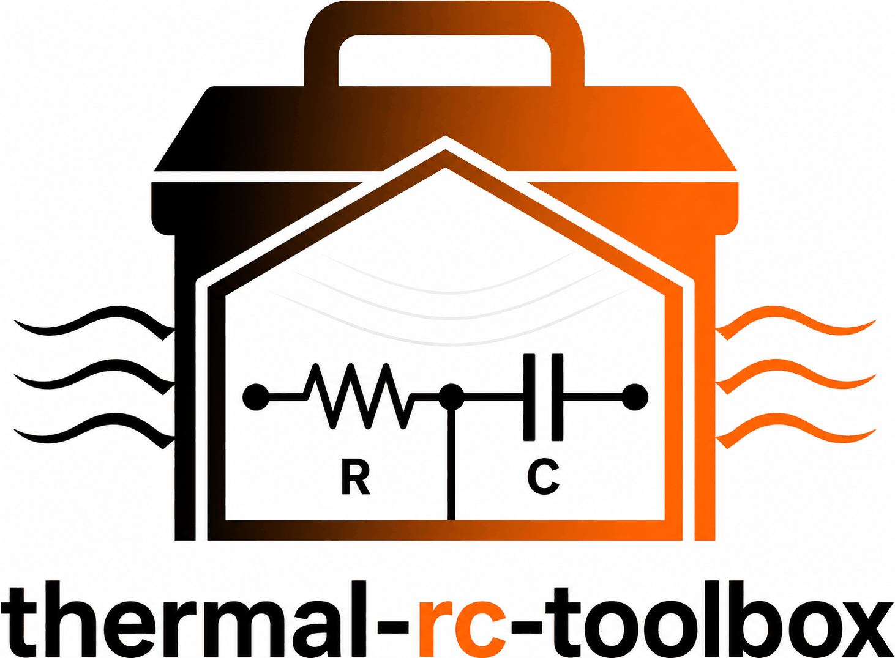
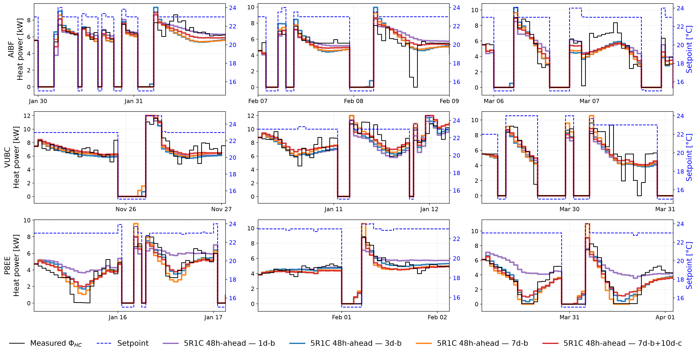
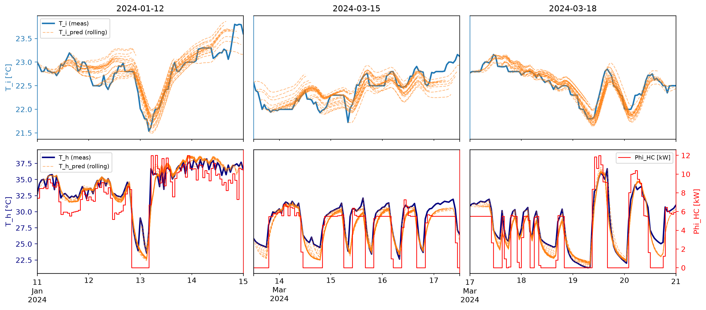

<p align="center">
  
</p>

`thermal-rc-toolbox` is a Python package for **grey-box thermal modelling
of buildings**. It supports arbitrary RC-network structures and provides a pipeline for parameter identification.

The identification pipeline is **GA-based**. Users configure the
**physics-based bounds on the parameter space** and the **objective function** the GA optimises against. The converged solution space is then
analysed via **clustering** to expose **parameter uncertainty** and reveal
**distinct groups of solutions**. Concretely, the pipeline
runs in three stages — **optimisation → selection → clustering**.

## Features
- **GA identification pipeline** (Pymoo): LHS sampling, SBX crossover, PM
  mutation, configurable physics constraints and objective functions.
- **Selection + clustering** of the final candidate pool (HDBSCAN) to
  reveal local optima in parameter space.
- **CLI** (`rct-train`) with numeric stage ranges — `--stage 1-3` runs
  the full pipeline, `--stage 2-3` re-tunes selection + re-clusters,
  `--stage 2` runs only selection. When the range does not start at
  stage 1 the optimizer is loaded from `optimizer.pkl` — no need to
  re-run the GA.
- **Built-in RC models**:
  - **5R1C EN ISO 13790** — forecasting of heat-power demand as function of thermostat setpoint and weather disturbances.
  - **Extended 6R3C EN ISO 13790** — joint forecasting of indoor air and supply water temperatures.
  - **2R2C** and **3R3C** — generic RC topologies for user-defined thermal networks.
- **Plugin registry** — drop in your own RC topology alongside the built-ins.

## Models

### 5R1C — EN ISO 13790:2008, heat-power forecasting
The reduced-order RC building model from EN ISO 13790:2008 is configured to take the thermostat setpoint as the control input and predict the heat pump’s thermal power required to satisfy it. The model also incorporates weather disturbances, including outdoor temperature and solar irradiance. By modeling the mapping between the thermostat setpoint and the resulting thermal power, it implicitly captures the actuation channel of the heat pump and its proprietary embedded controller.

<!-- <p align="center">
  
</p> -->

<p align="center">
  
</p>

### Extended 6R3C — EN ISO 13790, indoor + supply temperature forecasting

A 6-resistance, 3-capacitance structure derived from the EN ISO 13790
framework, targeting joint forecasting of the indoor air temperature and the
supply water temperature.

<p align="center">
  
</p>

## Install

The package is developed with [`uv`](https://docs.astral.sh/uv/). For the
reviewer-friendly path — clone, sync, run — you only need two commands:

```bash
git clone https://github.com/davudtopalovic/thermal-rc-toolbox.git
cd thermal-rc-toolbox
uv sync                              # creates .venv, installs everything
```

You now have an editable install of `rctoolbox` plus the dev tools
(JupyterLab, pytest). Common entry points:

```bash
uv run jupyter lab examples/         # open the tutorial notebooks
uv run pytest                        # run the test suite
uv run rct-train --help              # CLI help
```

## Quick start

### 1. Predict with a calibrated 5R1C model

```python
import json
from rctoolbox.models.rc.five_r1c_eniso13790.model import FiveR1C_ENISO13790

results_path = 'examples/run_identification/five_r1c_eniso13790/AIBF/results/results.json'
with open(results_path) as f:
    results = json.load(f)

model = FiveR1C_ENISO13790()
model.set_heat_power_range([0, results['setup']['building_config']['max_HP_power']])
model.set_initialization(
    init_config=results['setup']['identification_config']['model_config']['init_config']
)
model.set_params(results['results']['best_candidate']['params'])
```

Full walkthrough in [`examples/01_predict_with_5R1C.ipynb`](examples/01_predict_with_5R1C.ipynb).

### 2. Run an identification

Each subdirectory of `examples/run_identification/<model>/<building>/` is a
self-contained working example. It comes with pre-prepared training data
(`data_train.joblib`), a matching `identification_config.json`, and a
`train.ipynb` that wraps the pipeline. You can launch the identification two
equivalent ways:

**CLI** (scripted, reproducible):

```bash
cd examples/run_identification/five_r1c_eniso13790/AIBF
uv run rct-train \
  --building-config AIBF \
  --data-path data_train.joblib \
  --identification-config identification_config.json \
  --results-directory-path results \
  --seed 23 \
  --save-figures \
  --stage 1-3
```

**Notebook** (interactive, exploratory):

```bash
uv run jupyter lab examples/run_identification/five_r1c_eniso13790/AIBF/train.ipynb
```

Both produce the same `results/results.json` and figures under `results/figs/`.

#### Objective function

`optimization_config["objective_function"]` selects what the GA minimises:

- a **metric name** (`"MAE"`, `"MSE"`, `"RMSE"`, `"CV(RMSE)"`, `"RE"`, `"NMBE"`)
  uses the built-in objective, the metric's mean across windows plus
  `std_weight` times its spread;
- a **reference to your own function** `f(y_true, y_pred) -> float`, written
  as `"objectives.py:weighted_temp_objective"` (path relative to the config
  file or absolute) or `"package.module:function"`. In a notebook,
  `"__main__:function"` reaches a function defined in a cell, but such a run
  cannot be reproduced from the command line.

```json
"optimization_config": {
    "objective_function": "objectives.py:weighted_temp_objective",
    "pop_size": 100,
    "n_gen": 100
}
```

`--objective-function <value>` on the command line overrides the config entry;
either way the value used is written into `results.json`. The 6R3C VUBC
example weights the indoor-air and heating-circuit errors this way
([`examples/run_identification/six_r3c_eniso13790/VUBC/objectives.py`](examples/run_identification/six_r3c_eniso13790/VUBC/objectives.py)).

#### Early stopping

By default the GA runs for exactly `n_gen` generations. With
`early_stopping` it stops once the best fitness has improved by less than
`tol` over the last `patience` generations; `n_gen` is then the upper limit:

```json
"optimization_config": {
    "objective_function": "RMSE",
    "pop_size": 100,
    "n_gen": 300,
    "early_stopping": {"patience": 20, "tol": 1e-3, "min_gen": 20}
}
```

`tol` is in the units of the objective (`"relative": true` makes it a
fraction of the best fitness); `min_gen` is the earliest generation at which
the run may stop. The number of generations run and the reason for stopping
are logged and written to `results.json` under `results.optimization`
(`rctoolbox/identification/termination.py`).

#### Pipeline stages

`--stage N` or `--stage N-M` selects a contiguous range of stages with
`1 = optimize`, `2 = select`, `3 = cluster` (default `1-3`).

| Stage | What runs | What it produces |
|---|---|---|
| **1 · optimize** | GA loop → per-candidate `dfR` | `optimizer.pkl` — **no `results.json` yet** |
| **2 · select** | Picks `best_candidate = argmin(criteria)` over `dfR`. When `select_R_star=true` (default) also cuts $\mathcal{R}^*$ (`dfRtopN`) via `threshold_config` + computes distribution stats. | `results.json` (`best_candidate`), `dfRtopN.csv` |
| **3 · cluster** | HDBSCAN over `dfRtopN` → local optima in parameter space, plus per-cluster evaluation. | cluster summaries in `results.json` |

If the range does not start at stage 1, `optimizer.pkl` is loaded from
`--results-directory-path` — handy for re-tuning selection or clustering
without paying for the GA again:

| Command | Runs | Loads pkl? |
|---|---|---|
| `--stage 1-3` *(default)* | 1 → 2 → 3 | no |
| `--stage 1-2` | 1 → 2, skip clustering | no |
| `--stage 2-3` | 2 → 3, re-tune selection + re-cluster | **yes** |
| `--stage 2` | only selection | **yes** |
| `--stage 3` | only clustering *(needs `dfRtopN` on the loaded pkl)* | **yes** |

To skip $\mathcal{R}^*$ cutting inside stage 2 (get only
`best_candidate`, no `dfRtopN` or distribution stats), set
`selection_config.select_R_star` to `false`. This is incompatible with
stage 3 and is rejected before any work runs.

## Examples

Two kinds of examples come with the toolbox:

**Deep-dive tutorials — `examples/01_*.ipynb`, `examples/02_*.ipynb`.**
Heavily commented walkthroughs of *how* to use the toolbox:

- [`01_predict_with_5R1C.ipynb`](examples/01_predict_with_5R1C.ipynb) —
  loading a calibrated model from `results.json` and generating forecasts,
  including per-batch metrics and plotting.
- [`02_identification_pipeline.ipynb`](examples/02_identification_pipeline.ipynb) —
  step-by-step unrolling of what `rctoolbox.pipeline.run_pipeline` does
  internally (GA loop, selection, clustering). Read this when you want to
  extend or modify individual stages.

**Realistic identification runs — `examples/run_identification/<model>/<building>/`.**
Self-contained working examples, one per (model, building) pair. Each
directory bundles the training data, the identification configuration, a
`train.ipynb` that launches the run, and the resulting `results/` after a
completed run:

- [`five_r1c_eniso13790/AIBF/`](examples/run_identification/five_r1c_eniso13790/AIBF/) —
  5R1C EN ISO 13790 identification on the AIBF building (heat-power forecasting).
- [`six_r3c_eniso13790/VUBC/`](examples/run_identification/six_r3c_eniso13790/VUBC/) —
  extended 6R3C EN ISO 13790 identification on the VUBC building
  (joint indoor + supply temperature forecasting).

These are meant as **templates**: drop your own building's data + config into
a similar directory and reproduce the same pipeline end-to-end from either
the CLI or the notebook.

## Package layout

```
src/rctoolbox/
├── models/rc/
│   ├── five_r1c_eniso13790/   # 5R1C EN ISO 13790 (Numba-jitted)
│   ├── six_r3c_eniso13790/    # extended 6R3C EN ISO 13790
│   ├── two_r2c/               # generic 2R2C topology
│   └── three_r3c/             # generic 3R3C topology
├── data/                       # DataLoader + time-window generators
├── identification/             # GAOptimizer, problem classes, selection
├── pipeline/                   # run_pipeline orchestrator + model registry
├── evaluation/                 # forecast metrics + plotting
├── utils/                      # config loader, logging, seed, latex map
├── cli/                        # rct-train entry point
└── configs/buildings/          # AIBF.json, VUBC.json, P8EE.json
```

## Case studies bundled with the package

| ID   | Heat pump            | Heating system |
|------|----------------------|----------------|
| AIBF | Air-to-water (12 kW) | Radiators      |
| VUBC | Air-to-water (12 kW) | Floor          |

Default building configurations live at
[`src/rctoolbox/configs/buildings/`](src/rctoolbox/configs/buildings/).
Sanitised hourly datasets ship under
[`examples/data/`](examples/data/) as `AIBF_data.pkl`, `VUBC_data.pkl`.

> **Note on privacy.** For the bundled datasets, `Phi_sol` (solar
> irradiance) was fetched at a location different from the buildings'
> true coordinates, and the floor area in each building config is an
> approximation, not the exact value.

## Citation

If you use `thermal-rc-toolbox` in your research, please cite the
accompanying preprint:

> Topalović, D., & Gabrijelčič, D. (2026). *Data-Efficient Control-Oriented Gray-Box
> Framework for Setpoint-to-Thermal-Power Modeling of Residential Heat Pumps.*
> Preprint, SSRN. https://doi.org/10.2139/ssrn.7536923

```bibtex
@misc{topalovic2026dataefficient,
  author       = {Topalovi{\'c}, Davud and Gabrijel{\v{c}}i{\v{c}}, Du{\v{s}}an},
  title        = {Data-Efficient Control-Oriented Gray-Box Framework for
                  Setpoint-to-Thermal-Power Modeling of Residential Heat Pumps},
  year         = {2026},
  howpublished = {SSRN preprint},
  doi          = {10.2139/ssrn.7536923},
  url          = {https://ssrn.com/abstract=7536923}
}
```

A machine-readable citation will be maintained in [`CITATION.cff`](CITATION.cff).

## Funding

Development of `thermal-rc-toolbox` was supported by the
[RESONANCE](https://www.resonance-project.eu/) and
[INDEPENDENT](https://independent-energyproject.eu/) projects.

## License

[Apache License 2.0](LICENSE) — see `LICENSE` and `NOTICE` for the full text
and attribution.
